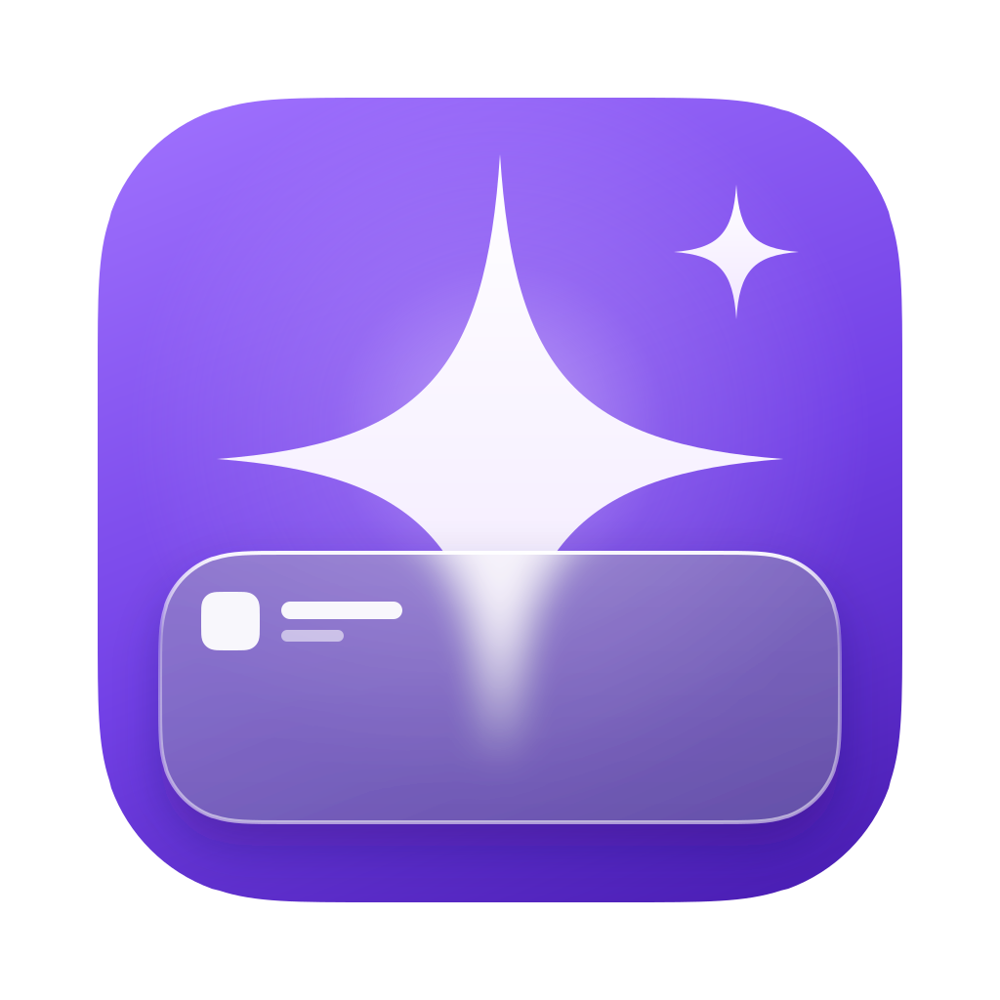

<p align="center">
  
</p>

<h1 align="center">SlopDrop</h1>

<p align="center">
  A native macOS menu bar app that collapses AI slop in your Slack desktop app.
</p>

<p align="center">
  <a href="#install">Install</a> ·
  <a href="#build-and-run">Build</a> ·
  <a href="#releases">Releases</a> ·
  <a href="#apps">Apps</a> ·
  <a href="#rules">Rules</a> ·
  <a href="#styles">Styles</a> ·
  <a href="#how-it-fits-together">How it fits together</a>
</p>

It does not patch Slack, fork Electron, or use the accessibility API. It starts
Slack with a loopback DevTools port, attaches over CDP, and injects a small agent
into every Slack window. The agent reads each message's real metadata — sender,
`bot_id`, `bot_profile.app_id`, message `metadata`, text — matches it against
rules pushed from the app, and applies a named style.

## Install

One command installs the newest release, verifies its checksum, and replaces any
existing copy. It downloads with `curl`, so macOS never quarantines the app and
there is no first-launch prompt:

```bash
curl -fsSL https://raw.githubusercontent.com/goldsky-io/slopdrop/main/Scripts/install.sh | bash
```

`--version v0.1.0` pins a release, and `--prefix ~/Applications` installs
somewhere other than `/Applications`.

Or take the `.dmg` from [Releases](../../releases/latest) and drag **SlopDrop** to
Applications. A browser download does get quarantined, so if macOS says the app
"could not be verified", clear that first:

```bash
xattr -dr com.apple.quarantine /Applications/SlopDrop.app
```

SlopDrop needs macOS 14 or later and runs natively on Apple silicon and Intel.
It then lives in the menu bar and attaches to Slack itself.

## Build and run

```bash
./Scripts/build-app.sh      # builds dist/SlopDrop.app and installs ~/Applications/SlopDrop.app
open -a SlopDrop
```

Pass `debug` for a debug build, or override the destination with
`INSTALL_DIR=/Applications ./Scripts/build-app.sh`. Re-running the script replaces
the installed copy; quit the running app first if you want the new build to launch.
`INSTALL_DIR= ./Scripts/build-app.sh` builds `dist/SlopDrop.app` and installs
nothing, `UNIVERSAL=1` builds arm64 plus x86_64, and `VERSION=1.2.0
BUNDLE_VERSION=3` stamps an explicit version instead of reading the newest tag.

No accessibility permission is required.

## Releases

A version tag builds and publishes the app on GitHub Actions — a universal
(Apple silicon and Intel) `.dmg`, a `.zip`, and `SHA256SUMS` attached to a GitHub
Release whose notes list what changed:

```bash
git tag -a v0.2.0 -m "SlopDrop 0.2.0"
git push origin v0.2.0
```

**Draft a new release** on the repository's Releases page does the same thing:
publishing it creates the tag, which starts the workflow. If a run fails,
**Actions → Release → Run workflow** with the tag rebuilds it.

The tag is the version. `v0.2.0` becomes `CFBundleShortVersionString` `0.2.0`,
a `-something` suffix marks the release as a prerelease, and the workflow run
number becomes `CFBundleVersion`, which macOS needs to only ever grow. Local
builds read the newest tag the same way. Builds are signed ad hoc rather than
notarized, which is why [Install](#install) leads with the script rather than a
browser download.

## Where it lives

SlopDrop sits in the menu bar. Its menu covers the everyday actions — mute on or
off, pick a message to mute, open Apps, check for updates — and **Settings…**
(⌘,) opens the main window: General, Apps and About, with search across apps.

The menu bar icon shows the state: the sparkle sunk into frosted glass while
muting, standing in front of the glass when Mute Slop is off, and hollow when
SlopDrop isn't attached to Slack.

Some systems refuse to place a new status item — a full menu bar, a notch, or an
OS that parks it off-screen — and then the app would be running but impossible
to reach. So on launch it checks whether the item actually landed in the bar; if
it didn't, SlopDrop shows in the Dock instead and opens Settings once to say so.
Clicking the Dock icon always opens Settings. **Show in Dock** keeps the icon
either way.

## Updates

SlopDrop checks for a newer release on launch and once a day. The check is one
HEAD request to `github.com/goldsky-io/slopdrop/releases/latest`, which
redirects to the newest release's tag; no API key, and nothing about you or
Slack is sent. When there is a newer version:

- **Settings › About** says so, with **Install and Relaunch**, and the About row
  in the sidebar carries a badge.
- The menu bar menu offers **Update to SlopDrop x.y.z**.
- A notification says so once, with an **Install** button, and again every three
  days while the update waits.

Installing downloads the release's `.zip` and `SHA256SUMS`, checks the hash,
confirms the archive holds SlopDrop at the expected version, swaps it in for the
running app, and relaunches it. Nothing is replaced until those checks pass. The
download isn't quarantined, so the new build opens without a Gatekeeper prompt.
Switching off **Check automatically** in Settings › About stops the daily check;
**Check for Updates…** still works by hand.

## Connection monitoring

Slack only reads `--remote-debugging-port` at launch, so staying attached means
restarting it whenever it comes back without the flag. SlopDrop checks the port
every two seconds and heals itself:

- **Attached** — reconnects to new windows and re-injects the agent after a reload.
  A DevTools connection that drops while its window stays open is replaced on
  the next check. SlopDrop subscribes to no console events, and a message it
  can't read (Chrome writes text cut mid-emoji as a lone `\ud83d`) is repaired or
  dropped on its own, never taken as the socket closing.
- **Slack running without the port** — waits 4s for it to finish booting, then
  quits and relaunches Slack with the flag. This covers Slack updates, crashes,
  and you launching Slack by hand.
- **Slack not running** — does nothing. SlopDrop never launches Slack on its own;
  once you open it, the case above picks it up.
- **Repeated failures** — backs off 5s, then 15s, showing the countdown in
  Settings. After a third failed restart it stops and shows the error until you
  press Connect. The count resets as soon as a connection succeeds.

Slack 4.53 and later only open the port when they run from a profile other
than the default one, so SlopDrop starts Slack with a profile of its own. Slack
is App-Sandboxed, so that profile has to sit inside Slack's container —
`--user-data-dir=~/Library/Containers/com.tinyspeck.slackmacgap/Data/Library/Application Support/SlopDrop/SlackProfile`.
Point it anywhere under `~/Library/Application Support` and Slack can't create
its store there: it quits a few seconds after launch with a fatal `EPERM`,
which looks like Slack crashing. The first time, that profile isn't signed in:
sign in to your workspaces once and it stays signed in from then on.

**Reconnect automatically** in Settings turns this off; the Connect button then
does it on demand instead. The first launch is the one that surprises people: if
Slack is already open, it restarts once, about four seconds after SlopDrop starts.

## Apps

Settings → Apps is a single list, like the ones in System Settings: every app,
bot and "Sent using" tool SlopDrop knows about, each with a switch to mute it.

- **All apps and bots** sits on top and is already on for a new install: every
  app and bot is muted, including ones that haven't posted yet, and you switch
  off the few you want to read.
- **Each row** is one app or tool. Its switch shows whether it's muted, whether
  by its own setting or by All apps. Hovering a muted row offers a style menu;
  a row with its own style shows it at rest, and **Default** hands it back to
  the All apps style.
- **Drag to reorder.** The order is the rules' priority: when two rows cover the
  same message, the higher one wins. Move Up and Move Down are in the context
  menu too, along with **Follow All Apps** (drop the row's own setting) and
  **Remove** for picked people and hand-written rules.
- **Pick from Slack** mutes whoever posted the message you click, and puts their
  row at the top.

What gets listed, ranked by evidence:

- **Slack's own flags.** Every installed app carries `is_ai_app` and
  `is_agent_app`; SlopDrop reads them from Slack's app state.
- **The name and description** — "AI", "assistant", Claude, Cursor, Steery, …
- **"Sent using …" posts.** Tools that post with a person's token leave a footer
  (`*Sent using* <@U0BUGMB8ML2>`, `*Sent using* Elliott's Brain`). The agent
  spots it in context blocks, or as an emphasised or final line, and resolves
  `<@U…>` mentions and names to the installed app. These are counted per tool.

Apps with enough evidence (marked ✦) and apps seen posting in your channels are
listed; every other installed app is one click away under **Show other installed
apps**. Observations are kept in `~/Library/Application Support/SlopDrop/seen.json`,
so the list improves as you read Slack.

## Rules

Behind the Apps page, each row you change is a rule in
`~/Library/Application Support/SlopDrop/rules.json`, which can be hand-edited:

```json
{
  "id": "apps",
  "name": "Apps",
  "enabled": true,
  "match": { "anyApp": true }
}
```

A rule without a `style` follows the style chosen under Settings → General (or,
for an app, the All apps style), so clicking a style there restyles Slack
straight away. Give a rule its own style (`"style": "blur"`, or a row's style
menu) to keep it fixed.

Matching is done in the renderer, against the message object Slack itself uses:

| field        | meaning                                                         |
| ------------ | --------------------------------------------------------------- |
| `anyApp`     | every app/bot message, and posts made through an app            |
| `botIds`     | `B…` bot ids                                                    |
| `appIds`     | `A…` app ids — the app's own posts and posts made with its help |
| `via`        | tool names from a "Sent using …" footer, lowercased             |
| `userIds`    | `U…` member ids                                                 |
| `names`      | display names (case-insensitive)                                |
| `channelIds` | `C…` channel ids                                                |
| `subtypes`   | message subtypes (`bot_message`, `channel_join`, …)              |
| `text`       | case-insensitive regular expression over the text               |
| `metadata`   | substring over the message's JSON metadata                      |

A message is judged by its own sender. One that carries another post — a shared
message, or a link preview of an app's post — doesn't become an app message
because of the "APP" badge on what it carries. Slack's own channel events —
someone joining or leaving, a topic or name change, an integration added or
removed, a pin — are never app posts either, even when Slack attaches the bot
id of the integration the event is about.

The first matching rule wins. SlopDrop sends rules in the order of the Apps
page, with All apps last; the dragged order is kept in the `appOrder` default.
An app switched off while All apps is on goes out as an allow rule
(`"style": "none"`): it matches and stops there, so the catch-all never reaches
the message, but it mutes nothing. A rule with no constraints matches nothing,
so an empty rule can never swallow a workspace.

## Styles

Styles are a registry in `Sources/SlopDrop/Resources/slop-agent.js`. Every style
keeps the avatar, name, and time readable; only the body changes. Grayscale is
the default, and the registry lists it first, so it leads the gallery too.

| id           | title     | effect                                                         |
| ------------ | --------- | -------------------------------------------------------------- |
| `monochrome` | Grayscale | grayscale at 20% opacity, in a card; repliers' faces stay lit  |
| `accordion`  | Fold      | sender plus the first line, led by a chip; click to unfold     |
| `blur`       | Frost     | frosted glass (`backdrop-filter`) over the body; hover to read |
| `dim`        | Dim       | 20% opacity until hover, in a card; repliers' faces stay lit   |
| `outline`    | Tag       | a card with an accent rail and a label line                    |
| `hide`       | Hide      | removed from the timeline                                      |

Dim, Grayscale and Tag put the message body in a card, like Slack's own shared
messages, and cut a long one off after about five lines with **Show more**,
drawn exactly like Slack's own expand link: Lato 13px bold in Slack's link
colour token (`--dt_color-content-hgl-1`), Slack's chevron, 4px under the text.
The cut lands on the last whole line, and only when it hides at least two more,
so it never trades one line for a link; **Show less** folds it back. Both toggle
on a click, never on a drag, and the choice sticks while you scroll. The card is
drawn with CSS on Slack's own body parts, and each cut is measured once per row
and kept in generated CSS (`sd-cuts`), so Slack's nodes stay untouched. Frost is
already a card of glass, and Fold already shows a single line.

Thread previews follow the people in them. Dim and Grayscale mute the message
itself, not the thread preview under it. And in every thread preview — under
muted messages and ordinary ones alike — the face of a replier who is slop
themselves is muted in the style of their own rule: a bot (by user id, or by
bot id for bots without a user) under an app rule, a person under a person
rule. Slack's own member record decides who is a bot: a bot message can carry a
person's id (legacy integrations post as whoever installed them), and that
never turns the person into a bot. Dim fades the face exactly like a Dim
message; Grayscale, and every style with no face equivalent (Fold, Frost, Hide),
grays it like a Grayscale message; Tag never mutes, so the face stays. Both
looks come from one `MUTE` table in `slop-agent.js`, so a face always matches
its style. Faces are matched by id from Slack's own props and marked on the row,
so Slack's nodes stay untouched, and hovering the message reveals them.

A person counts as slop in a thread when their replies there are: every reply
of theirs was made with a muted tool ("Sent using Claude" under All apps), so
their face mutes like the tool's posts. SlopDrop reads replies from Slack's own
store (read only) and remembers the ones it has drawn in an open thread. It only
judges a replier by their replies once every reply in the thread is known, so
someone who also wrote a reply by hand is never muted by mistake. Slack keeps a
thread's replies in memory once you've opened it, or when they arrived while
Slack was running; an older thread you haven't opened keeps its faces lit.

The reply count ("7 replies") is muted only when every replier is slop. One
person in the thread and it stays as Slack draws it — including under a slop
message that people answered. Repliers are read from the message's own reply
list, not just the faces Slack shows; Slack lists only a few of them next to a
total, so when the total is larger than the list the count stays too, since not
everyone can be checked. A muted count takes the repliers' look: gray if any of
them is gray, otherwise dim.

Fold and Tag put their chip in one place for every message — the start of the
first line of content — whether or not the row shows a sender, in channels and
in threads alike. It takes real space, so it never covers text, and it stays
clear of Slack's hover toolbar on the right. Clicking a message folds or unfolds
it, both ways and immediately; once unfolded, the chip moves onto its own line
in the same spot. A press that moves before release is a drag-select and never
toggles, nor does a click while text is selected in the message, and the second
click of a double-click is ignored so the message never bounces. Slack's own
controls keep working and never toggle: links, mentions, buttons, images, the
toolbar, the sender's name and avatar, the timestamp. The chip lights up
whenever a click would toggle the message.

Adding a style means adding one entry to `STYLES` (id, title, blurb, CSS). The
app reads that registry at runtime, so no Swift changes are needed. Styles are
pure CSS keyed off `data-sd-style` on the message row — the agent never inserts,
removes, or reorders Slack's nodes, so React reconciliation can't fight it. Chip
text travels in a CSS custom property for the same reason. Colours follow
Slack's light or dark theme, and `prefers-reduced-transparency` turns Frost solid.

Prefer height-neutral styles (Frost, Dim, Grayscale, Tag) when you want scrolling
to stay perfectly stable: Slack's message list is virtualized, and shrinking rows
makes it re-measure.

## How it fits together

```
Sources/SlopDrop/
  SlopDropApp.swift              app delegate, main menu
  AppModel.swift                 attach loop, Apps rows, rule order, pick-to-rule
  CDP/CDPConnection.swift        WebSocket JSON-RPC to Slack's renderer
  CDP/SlackBridge.swift          target discovery, agent injection, sampling
  CDP/SlackLauncher.swift        restart Slack with --remote-debugging-port
  Rules/Rule.swift               rule model, tolerant decoding, pick → rule
  Rules/RuleStore.swift          JSON persistence
  Rules/Suggestions.swift        catalog, observed tallies, scoring
  Rules/AppEntry.swift           one Apps-page row: app or tool plus its rule
  UI/StatusController.swift      menu bar item and menu, Dock fallback
  UI/AboutPane.swift             version, updates, links
  UI/SettingsWindowController.swift  the Settings window
  UI/SettingsView.swift          sidebar, search, routing
  UI/GeneralPane.swift           mute, connection, default style
  UI/AppsPane.swift              the Apps list: switches, styles, drag to reorder
  UI/StylePreview.swift          style preview tiles
  UI/Theme.swift                 palette, cards, buttons, icons
  UI/IconStore.swift             Slack avatars, fetched through Slack
  Resources/slop-agent.js        renderer agent: metadata, matching, styles
  Resources/MenuBar*.png         menu bar template images, 1x and 2x
  Updates/Release.swift          versions, the latest-release lookup, error text
  Updates/UpdateInstaller.swift  download, checksum, identity check, bundle swap
  Updates/Updater.swift          schedule, state, notifications, relaunch
Scripts/build-app.sh             builds dist/SlopDrop.app, installs it locally
Scripts/install.sh               installs a release with curl, no Gatekeeper prompt
.github/workflows/release.yml    tag → universal .dmg and .zip on a GitHub Release
Assets/
  AppIcon.icns                   app icon, copied into the bundle by build-app.sh
  AppIcon.iconset/, AppIcon.png  the same icon as PNGs
  Source/icons.py                draws every icon; SVG masters beside it
```

Every 2 seconds the app re-lists Slack's DevTools targets, connects to new
windows, attaches the agent at document start (so a Slack reload keeps working),
samples `window.__slop.getStats()`, and drains new observations. The app catalog
is refreshed every two minutes.

Inside Slack, the agent styles rows from its mutation observer. Slack's message
list mounts rows a little past the viewport and recycles them as you scroll;
observer callbacks run after Slack inserts a row and before the browser paints
it, so a muted message is never painted unstyled, even mid-fling. Only the rows
that changed are restyled, and a slower full pass every couple of seconds keeps
stats and the light/dark theme current. The folded chip is lowered onto the
baseline of the message's first line, and the fold is clipped exactly where
that line ends — taller things on it (emoji, mention pills, inline code) grow
it, the second line never peeks in — both measured from the rendered text and
its font metrics, with no changes to Slack's DOM.

## Icons

`python3 Assets/Source/icons.py` (Pillow and `rsvg-convert`) redraws everything
from the geometry in that file: the SVG masters, `Assets/AppIcon.iconset`,
`Assets/AppIcon.icns`, `Assets/AppIcon.png`, and the menu bar images in
`Sources/SlopDrop/Resources/`. `Assets/preview.png` shows the set.

The app icon sits on the macOS grid: an 824px continuous-corner body on a
1024px canvas, with nothing outside the body. macOS 26 and later put an icon
whose pixels spill past that shape on a gray plate. 16pt art drops the small
sparkle and the sender line; 32pt art drops the sender line.

The menu bar images are templates (black and alpha) on an 18pt canvas, so
AppKit tints them for light, dark, and highlighted bars.

## Security

The DevTools port only listens on `127.0.0.1` and only exists while Slack runs
with the flag. Any local process that can reach it can inspect and drive your
Slack session, which is the same trust boundary as Slack itself. Quitting and
reopening Slack normally (without SlopDrop) closes the port.

Apart from the update check, SlopDrop makes no network requests of its own:
everything else goes to `127.0.0.1`. The check is one request to github.com a
day, plus the download when you install a release. App icons are fetched by Slack
through `Network.loadNetworkResource` and cached in
`~/Library/Application Support/SlopDrop/icons`, so with **Check automatically**
off a firewall can deny SlopDrop outbound access entirely.

## Caveats

Slack owns its DOM. The agent reads `data-qa` attributes and Slack's React fiber
props, and falls back to DOM-only metadata if the fiber shape changes. A Slack
release can still break matching; when that happens, Settings reports zero
matched messages and the fix is confined to `slop-agent.js`.
